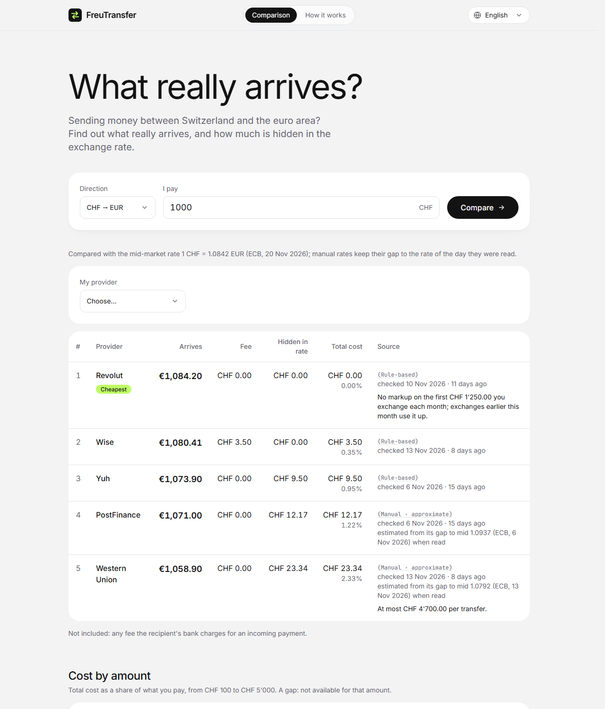
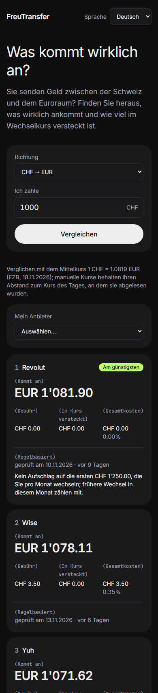
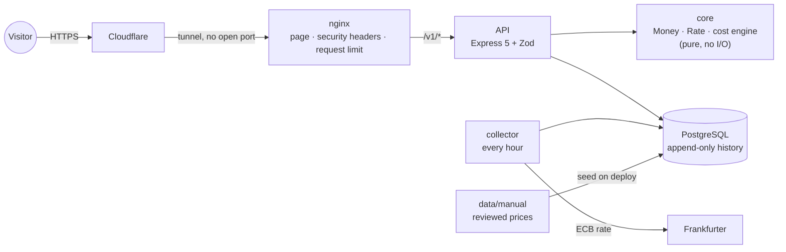

# FreuTransfer — Cost Comparer

What **really arrives** when you send money between **Switzerland and the euro area** (CHF → EUR
and EUR → CHF), and how much of the cost is **hidden in the exchange rate**. In English, German,
French and Italian.

**Live:** https://freutransfer.aelshafey.com · **API:** [`/v1/openapi.json`](https://freutransfer.aelshafey.com/v1/openapi.json)
and its [documentation page](https://freutransfer.aelshafey.com/en/api) · Status: stages 0–7 of
the [roadmap](docs/progress.md)

<p>
  
  
</p>

## The problem

A transfer with a small or no visible fee can still cost a lot: the provider converts at a rate
worse than the market's, and that markup shows on no receipt. FreuTransfer measures every
provider against the same official reference rate and splits the cost into what you see and
what you don't.

## How the cost is measured

One formula for every provider ([Project Plan §3](Project%20Plan.md)), with the European Central
Bank's reference rate as the fair rate:

```
total cost   = what you pay − what arrives ÷ reference rate
hidden cost  = total cost − visible fee
cost in %    = total cost ÷ what you pay
```

**Example:** you pay 1,000.00 CHF. The provider takes a 5.00 CHF fee and converts the remaining
995.00 at 1.05 while the reference rate is 1.07. 1,044.75 EUR arrive, worth 976.40 CHF at the
reference rate: the total cost is **23.60 CHF (2.36%)**, of which **18.60 CHF** is hidden in the
rate. (This example is a test: `apps/web/src/methodology-values.test.ts` recomputes it with the
real engine.)

Every amount is exact (decimal arithmetic) and rounded once, at the end, half-even to the cent.
The full method, in four languages, is on the site's
[methodology page](https://freutransfer.aelshafey.com/en/methodology).

## Where the numbers come from

| Source | What | How |
|---|---|---|
| **ECB reference rate** via [Frankfurter](https://frankfurter.dev) | the fair rate | collected every hour; each response stored unchanged before it is read |
| **Rule-based** (Wise, Yuh, Revolut) | published fee + markup | applied to today's reference rate, for any amount |
| **Manual** (PostFinance, Western Union) | a published rate | read by hand at a known time; its distance from that day's reference rate is applied to today's (ADR 0010), marked "approximate" |

Every price carries its source link and the day it was checked, and is verified by hand before
it is loaded. Guards keep wrong data off the ranking: a price not re-checked for more than 30
days is listed apart; a total cost above 10% or below 0% is treated as a data error ("being
checked"); a reference rate older than 5 days shows a warning. No scraping, no use of sources
whose terms forbid it (ADR 0003).

## Architecture



- **Modular monolith, hexagonal:** `packages/core` is the pure domain (no I/O, no other workspace
  imports); `packages/db` implements its ports with Prisma and returns core types; the API's
  handlers only validate (Zod) and call core use cases.
- **Money is never a JS `number`:** `Money`/`Rate` value objects on decimal.js; amounts cross the
  API as strings, and the page formats them with `Intl` without converting them.
- **History is evidence:** rates, prices and raw responses can't be updated or deleted (database
  triggers); a correction is a new row, a provider leaves with a withdrawal entry (ADR 0009).
- **One source for every shape:** the API's responses are Zod schemas, which give the TypeScript
  types the page imports and the OpenAPI description (ADR 0014).

| Layer | Stack |
|---|---|
| Runtime | Node 26 LTS (TypeScript 7 run directly, type stripping), pnpm workspaces |
| Domain | decimal.js, fast-check property tests |
| API | Express 5, Zod 4, OpenAPI 3.1 |
| Data | PostgreSQL 18, Prisma 7 (no SQL built from strings) |
| Page | React 19, Vite 8, Tailwind 4, plain-SVG charts (ADR 0012) |
| Quality | Vitest (about 490 tests; real Postgres and real nginx in Docker via Testcontainers), Biome, knip |
| Production | Docker Compose on a VPS, Cloudflare Tunnel, GitHub Actions → GHCR, daily backups copied to Cloudflare R2, a daily check from outside that e-mails on any problem |

## Security and privacy

- No account, no cookies, no analytics, nothing loaded from other sites. The logs keep IP
  addresses shortened (ADR 0013); the [privacy page](https://freutransfer.aelshafey.com/en/privacy)
  says what is processed, in four languages.
- Content-Security-Policy `'self'` (plus `data:` for fonts and images), HSTS and other headers on every response; 10 API
  requests a second per visitor (nginx, keyed by Cloudflare's client address).
- No open port: the server is reached only through an outbound Cloudflare Tunnel (ADR 0004);
  the API and the page run as non-root users; every container runs without Linux capabilities
  (Postgres keeps the five it needs to start) and with `no-new-privileges`; Postgres isn't published.
- Supply chain: every GitHub Action pinned to a commit; pnpm refuses any package version younger
  than 7 days. Deploys need the owner's approval, and the deploy key can only run one script, for
  commits on `dev` (ADR 0006).

## Decisions

Each significant choice is an Architecture Decision Record in [`docs/adr`](docs/adr):

| ADR | Decision |
|---|---|
| [0001](docs/adr/0001-stack-and-architecture.md) | Stack and architecture |
| [0002](docs/adr/0002-hosting-on-ovh-vps.md) | Production on a VPS |
| [0003](docs/adr/0003-no-wise-data-frankfurter-and-manual.md) | Frankfurter for the reference rate; rule-based and manual provider prices; no Wise API data |
| [0004](docs/adr/0004-public-access-via-cloudflare-tunnel.md) | Public access through a Cloudflare Tunnel |
| [0005](docs/adr/0005-languages-en-de-fr-it.md) | Four languages, an address per language |
| [0006](docs/adr/0006-releases-deploys-and-backups.md) | Releases, approved deploys, backups |
| [0007](docs/adr/0007-collector-schedule-in-compose.md) | The hourly collector as a Compose service |
| [0008](docs/adr/0008-v1-scope-chf-eur-both-ways.md) | v1 scope: CHF ⇄ EUR |
| [0009](docs/adr/0009-withdrawing-a-provider.md) | Withdrawing a provider without deleting history |
| [0010](docs/adr/0010-manual-rates-at-todays-reference-rate.md) | Manual rates moved to today's reference rate |
| [0011](docs/adr/0011-page-design-foundation.md) | Page design foundation |
| [0012](docs/adr/0012-charts-as-plain-svg.md) | Charts as plain SVG |
| [0013](docs/adr/0013-logs-without-full-ip-addresses.md) | Logs without full IP addresses |
| [0014](docs/adr/0014-openapi-from-zod-schemas.md) | OpenAPI generated from the Zod schemas |
| [0015](docs/adr/0015-fee-model-without-min-max-and-tiers.md) | Fee model without minimum/maximum fees and fee tiers |

## Quick start

Requirements: Node.js 26.13 LTS, pnpm 12, Docker Desktop.

```sh
pnpm install
pnpm check        # Prisma generate + lint + knip + typecheck + tests (Docker must run: DB tests use Testcontainers)
pnpm db:up        # Postgres 18.6 on 127.0.0.1:5434
pnpm db:migrate   # apply migrations to it
pnpm db:seed      # load the verified entries from data/manual/
pnpm collect      # fetch the reference rates once (production does this every hour)
pnpm dev:api      # http://localhost:3000/v1/openapi.json
pnpm dev:web      # http://localhost:5173
```

```sh
curl "http://localhost:3000/v1/compare?from=CHF&to=EUR&amount=1000"
```

## Repository layout

| Path | Purpose |
|---|---|
| `packages/core` | Pure domain: money, rates, cost engine, ports (no I/O) |
| `packages/db` | Prisma schema, migrations, repositories (return core types) |
| `packages/collectors` | Data collectors: the reference rate from Frankfurter, every hour in production (`pnpm collect`) |
| `apps/api` | Express 5 HTTP API; response shapes as Zod schemas (`src/schemas.ts`), the OpenAPI description at `/v1/openapi.json`, the types the page imports in `src/contract.ts` |
| `apps/web` | React + Vite frontend; `src/i18n` holds the four languages (ADR 0005) |
| `compose.prod.yml`, `apps/*/Dockerfile` | The production stack; runbook in [`docs/deploy.md`](docs/deploy.md) |
| `scripts/deploy.sh`, `deploy/backup` | Deploying one commit on the server; database backups and their off-site copies |
| `data/manual` | Reviewed provider prices, each with source link and date (ADR 0003); the two reference rates read by hand before the collector |
| `docs/adr` | Architecture Decision Records |

## How work is done

Work happens on short-lived `step-<n>/<name>` branches, merged into `dev` by pull request once CI
passes. Until v1.0, `dev` is what runs in production: a merge builds the images and, after the
owner's approval, deploys them ([`docs/deploy.md`](docs/deploy.md)). `main` receives `dev` once,
as v1.0. The project rules are in [`CLAUDE.md`](CLAUDE.md), the scope in
[`Project Plan.md`](Project%20Plan.md), each stage's log in [`docs/progress.md`](docs/progress.md),
and the review method and its findings in [`review.md`](review.md).

---

Estimates for information only, not financial advice. Provider names are used only to identify
them; FreuTransfer has no business relationship with any of them.
